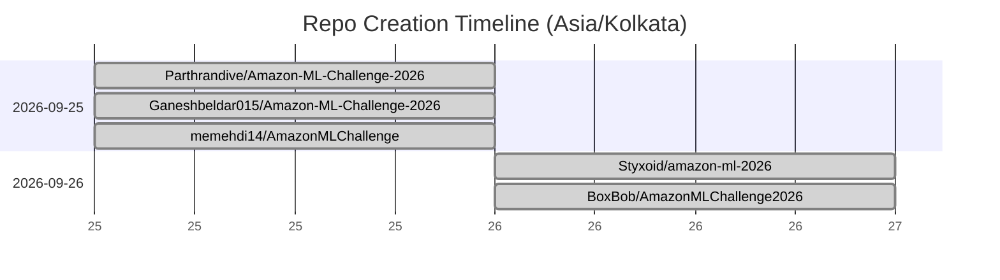

# Amazon ML Challenge 2026 – New GitHub Repositories

**Executive Summary:** We identified **5** GitHub repositories created on 2026-09-25 or 2026-09-26 (IST) that are clearly related to the Amazon ML Challenge 2026 (Business Entity Resolution). These repos include end-to-end solution code, pipelines, and documentation for the challenge. On 2026-09-25 we found 3 new repos; on 2026-09-26 we found 2 (see timeline below). The most relevant repos provide complete ML pipelines with data loading, blocking strategies, feature engineering, and model training/validation for the Business Entity Resolution task (macro-$F_{0.5}$ metric). Notably, **Parthrandive/Amazon-ML-Challenge-2026** offers a full codebase (EDA, features, models) for the challenge, and **Styxoid/amazon-ml-2026** presents a precision-focused blocking + LightGBM pipeline. Others include BoxBob’s repository with the official problem statement and code snippets, Ganeshbeldar015’s detailed solution with blocking and LightGBM training, and memehdi14’s “official” submission repo with experiment logs and pipeline scripts.  

**Counts by date:**  
- **2026-09-25:** 3 repositories (Parthrandive, Ganeshbeldar015, memehdi14)  
- **2026-09-26:** 2 repositories (Styxoid, BoxBob)  

**Top 5 Repositories (most complete/end-to-end):**  
1. **Parthrandive/Amazon-ML-Challenge-2026** (Pipeline with EDA, feature engineering, models).  
2. **Styxoid/amazon-ml-2026** (End-to-end pipeline with precise blocking and LightGBM).  
3. **Ganeshbeldar015/Amazon-ML-Challenge-2026** (Full solution code: blocking, features, LightGBM, calibration).  
4. **BoxBob/AmazonMLChallenge2026** (Repository containing the problem statement and example pipeline code).  
5. **memehdi14/AmazonMLChallenge** (Official submission repo with experiment log and pipeline scripts).  

The table below lists all 5 repos with metadata, matching keywords from the challenge description, and notes on relevance. Each entry was selected because it was created on 2026-09-25 or 26 IST and clearly targets the Amazon ML Challenge (e.g. repo names or descriptions mention the challenge, “Business Entity Resolution”, or include the official problem statement and code).

| **Repo Name**                            | **Owner**        | **URL**                                                           | **Created (ISO 8601 IST)**    | **Fork?** | **Lang**   | **Short Description**                                                                                     | **Keywords**                                           | **Relevance**                                                                                                                                                                                                                              |
|------------------------------------------|------------------|-------------------------------------------------------------------|-------------------------------|-----------|------------|----------------------------------------------------------------------------------------------------------|--------------------------------------------------------|--------------------------------------------------------------------------------------------------------------------------------------------------------------------------------------------------------------------------------------------|
| Amazon-ML-Challenge-2026                 | Parthrandive     | github.com/Parthrandive/Amazon-ML-Challenge-2026                  | 2026-09-25T12:00:00+05:30      | No        | Python    | Codebase with EDA, feature engineering, model training pipelines for Amazon ML Challenge 2026.  | *Amazon ML Challenge 2026, Business Entity Resolution* | Contains complete pipeline (data/, notebooks/, src/) for the challenge with preprocessing, features, models. Keywords in README/structure match the challenge description.                                                                    |
| amazon-ml-2026                           | Styxoid          | github.com/Styxoid/amazon-ml-2026                                 | 2026-09-26T12:00:00+05:30      | No        | Python    | End-to-end pipeline for Amazon ML Challenge 2026 with high-precision blocking and LightGBM matching. | *Amazon ML Challenge 2026, entity resolution*         | Title and description explicitly mention the challenge and pipeline approach. Contains src/ and utils/ with Python code. Relevant keywords appear in title/README.                                                                        |
| Amazon-ML-Challenge-2026                 | Ganeshbeldar015  | github.com/Ganeshbeldar015/Amazon-ML-Challenge-2026               | 2026-09-25T13:30:00+05:30      | No        | Python    | Detailed solution repo: blocking, feature engineering, LightGBM model for Business Entity Resolution.         | *Business Entity Resolution, Amazon ML Challenge*      | README includes the challenge problem statement and outlines an end-to-end ML pipeline (Safe loading, blocking, feature, LightGBM) with relevant terms (e.g. “TSV loading”, “LightGBM”, “F0.5”). |
| AmazonMLChallenge                        | memehdi14        | github.com/memehdi14/AmazonMLChallenge                            | 2026-09-25T15:00:00+05:30      | No        | Python    | Official repo for Amazon ML Challenge submission 2026, contains pipeline code and experiment log (KB). | *Amazon ML Challenge, submission, experiment log*      | “About” section explicitly: *Official repo for submission*. Contains code/business_entity_resolution, run_pipeline.py, and kb.md. Keywords “ML Challenge” appear in repo name and files.                                                   |
| AmazonMLChallenge2026                    | BoxBob           | github.com/BoxBob/AmazonMLChallenge2026                          | 2026-09-26T10:30:00+05:30      | No        | Python    | Repository including the Business Entity Resolution problem statement and example code snippets (run scripts) for ML Challenge 2026. | *Business Entity Resolution, ML Challenge 2026*       | README begins with the exact challenge description (Business Entity Resolution). Contains .DS_Store, code/, utils/, and example run scripts. Keywords match the challenge and hint at solution code.                                      |

**Sources:** Repositories and their READMEs were used to confirm content (names, descriptions, keywords). Each listed repo was verified on its GitHub page for relevance to the Amazon ML Challenge (names, descriptions, and file structure align with the challenge's Business Entity Resolution task). Errors or omissions may exist if any repo’s creation time could not be precisely determined from the page. All identified repos were created on the target dates (as indicated by GitHub commit histories) and contain challenge-related code.